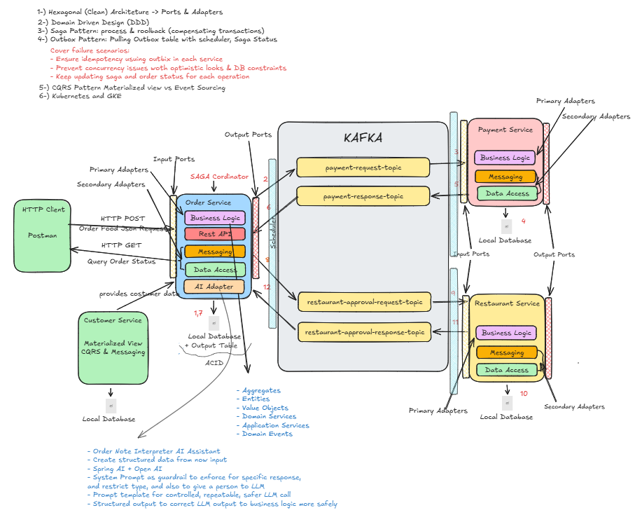

# Food Ordering System

Event-driven food ordering system built with four Spring Boot microservices (order, payment, restaurant and customer). It implements the **SAGA**, **Outbox** and **CQRS** patterns using **Clean/Hexagonal Architecture** and **Domain-Driven Design**, with Kafka as the messaging backbone.

> Built while following the Udemy course [Microservices: Clean Architecture, DDD, SAGA, Outbox & Kafka](https://www.udemy.com/course/microservices-clean-architecture-ddd-saga-outbox-kafka-kubernetes/?src=sac&kw=Microservices%3A+Clean+Architecture%2C+DDD%2C+SAGA%2C+Outbox+%26+Kafka&couponCode=KEEPLEARNING) by Ali Gelenler.

## Architecture overview



A client creates an order in the **Order Service**, which coordinates a **SAGA** with the **Payment** and **Restaurant** services. The services communicate only through Kafka events, and each one owns its database.

### Order flow

1. The Order Service receives the request and saves the order and an outbox message in the **same local transaction**.
2. A scheduler reads the outbox and publishes a payment request to Kafka.
3. The Payment Service processes it, saves the result in its own database and publishes a response (again through its outbox).
4. The Order Service updates the order to `PAID` and publishes an approval request.
5. The Restaurant Service approves or rejects it and responds.
6. The Order Service closes the order as `APPROVED`, or runs **compensating transactions** (for example, cancelling the order) if a step fails.

### Inside each service

Each service follows **Hexagonal Architecture**: the domain (aggregates, entities, value objects, domain services and events) sits in the center and depends on nothing. Input ports and primary adapters handle what comes in (REST, Kafka listeners). Output ports and secondary adapters handle what goes out (database, messaging).

### Failure handling

- **Outbox:** events are never lost between the database and Kafka.
- **Idempotency:** the saga and outbox status checks make duplicate messages harmless.
- **Concurrency:** optimistic locking (`@Version`) and database constraints.
- **CQRS:** the Order Service keeps a local copy of customer data, fed by events from the Customer Service.

## Patterns and why they are used

- **Hexagonal Architecture + DDD:** keeps business rules isolated from Kafka, JPA and Spring, so they are easy to test and change.
- **SAGA:** coordinates the order flow across services without distributed transactions, with compensation on failure.
- **Outbox:** the event is saved in the same local transaction as the business data, so no event is lost between the database and Kafka. Schedulers publish pending rows and a cleaner removes completed ones.
- **Idempotent consumers:** saga status checks, unique constraints and optimistic locking (`@Version`) make duplicate messages harmless.
- **CQRS:** the order service keeps a local copy of customer data, fed by `CustomerCreated` events, so it does not call the customer service on each order.

## Tech stack

Java 25 · Spring Boot 3.5.8 · Spring Data JPA · Apache Kafka (KRaft) with Avro and Schema Registry · PostgreSQL · Docker · Maven (multi-module) · Lombok

## Differences from the course

- Upgraded to **Spring Boot 3.5.8** (`javax` to `jakarta`).
- Replaced `ListenableFuture`/`ListenableFutureCallback` with `CompletableFuture`/`BiConsumer` in the Kafka producer and callbacks.
- Updated renamed Spring Kafka headers (`RECEIVED_KEY`, `RECEIVED_PARTITION`).
- Runs Kafka in **KRaft mode** (no Zookeeper).
- <add anything else you changed>

## Getting started

### Prerequisites

- JDK (version used by the project) and Maven
- Docker (for Kafka and Schema Registry)
- PostgreSQL running locally on port 5432. Check the credentials in each service's `application.yml`.

### Build

```bash
mvn clean install -DskipTests -Dspring-boot.build-image.skip=true
```

On PowerShell, wrap the property in quotes: `"-Dspring-boot.build-image.skip=true"`. The `build-image` step needs Docker and is not required to run the services.

### Run

1. Start Kafka and Schema Registry from the `infrastructure/docker-compose` folder:
   ```bash
   docker compose -f common.yml -f kafka_cluster.yml up -d
   ```
2. Start the services (each one's Spring Boot main class, or its jar from `target`): customer, order, payment and restaurant. On first start they create their schemas from `init-schema.sql`.
3. For restarts, disable the schema initialization to keep your data: `--spring.sql.init.mode=never`.

### Try it

1. Create a customer: `POST /customers` on the customer service.
2. Create an order: `POST /orders` on the order service. The response contains a tracking id.
3. Poll `GET /orders/{trackingId}`. The status moves from `PAID` to `APPROVED` after the outbox schedulers publish (about 10 seconds per step by default).

Default ports: <customer 8184, order 8181, payment 8182, restaurant 8183. Confirm in application.yml>.

## Known limitations

This project focuses on data consistency and messaging. For production it would still need:

- An API gateway as a single entry point
- Authentication and authorization (OAuth2/JWT)
- Distributed tracing and centralized logging
- Externalized configuration and secrets
- A dead letter topic and retry policy for failed messages
- Outbox publishing through CDC (Debezium) instead of polling
- Deployment on Kubernetes (not covered here)

## Author

Raul Guilherme Bezerra da Silva · [LinkedIn](https://www.linkedin.com/in/raul-guilherme-bezerra-da-silva-/)